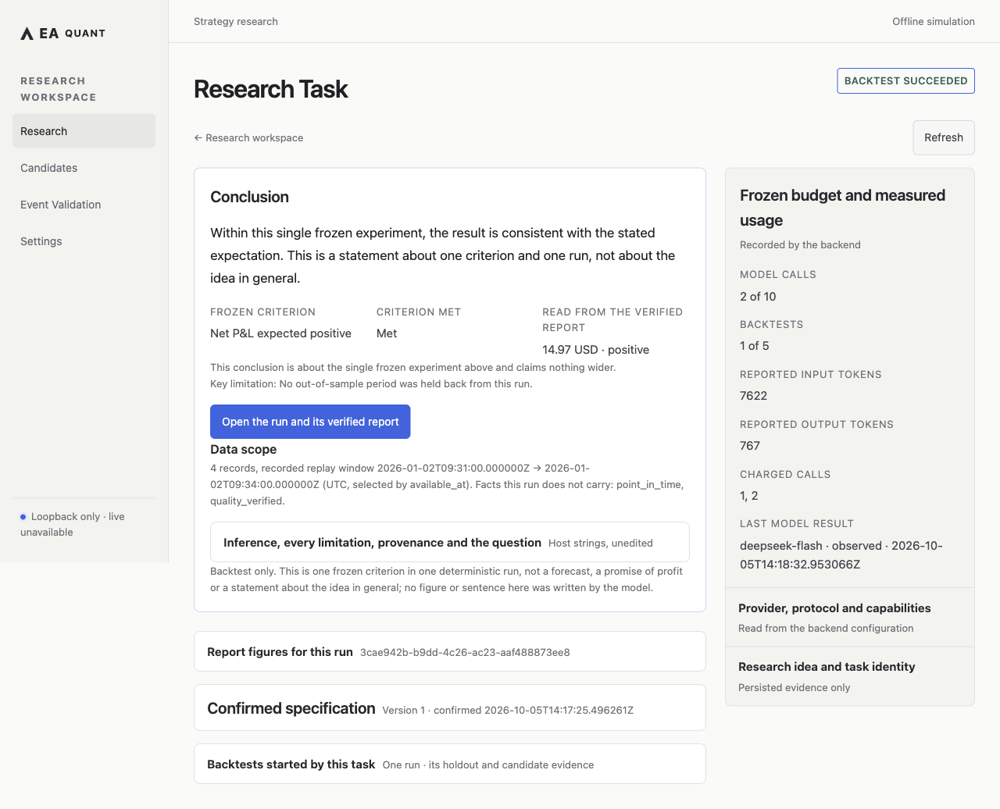

# EA Quant Trading System

EA is an AI-native quantitative R&D and strategy-promotion system in development. This candidate
delivers one **local research loop**: an idea, a registered and frozen strict spec, one explicit real
backtest, its formal report, one bounded evidence conclusion, and a durable refresh. The
deterministic engine runs offline on `127.0.0.1`; the two model-backed steps call the provider you
configure. External Paper providers and Live trading remain unavailable, and simulated Paper under
macOS `launchd` is a separate runtime you install and activate explicitly.

## Current Status

| Capability | Status |
| --- | --- |
| Local offline research / backtest | **AVAILABLE** |
| Loopback Web research loop | **AVAILABLE** |
| Model-backed spec proposal and conclusion | **AVAILABLE WHEN A MODEL PROVIDER IS CONFIGURED** (unconfigured by default) |
| Mac-local simulated Paper + crash/recovery/backup/alerts | **AVAILABLE** (separate runtime) |
| 72-hour / 7-day Paper soak | **NO PASS RECORDED** |
| External Paper provider | **NOT AVAILABLE** |
| Live trading | **DENIED / NOT AVAILABLE** |

Durable state: [STATUS](docs/STATUS.md) · Workflow: [WORKFLOW](docs/governance/WORKFLOW.md) ·
Contributing: [CONTRIBUTING.md](CONTRIBUTING.md) · Full inventory, verification evidence and
pending gates: [research-first-release.md](docs/research-first-release.md).

## Quick Start — the local research loop

Uses the repository's own bootstrap, the locked frontend build, and the existing loopback server. No
broker, no external service, and no key are needed for backtests and reports.

```bash
# 1. Repository-local Python environment (locked).
python3 scripts/bootstrap_local.py
# 2. Add the Web extra to that same environment (locked); bootstrap installs the dev extra only.
UV_PROJECT_ENVIRONMENT=venv uv sync --locked --extra dev --extra web
# 3. Build the frontend from the lockfile.
(cd apps/web && npm ci && npm run build)
# 4. Serve the real UI on loopback with explicit, separate local roots.
mkdir -p "$HOME/ea-web-workspace"
venv/bin/ea web serve \
  --scenario-root examples/web-scenarios \
  --workspace "$HOME/ea-web-workspace" \
  --ui-dir apps/web/dist \
  --port 8765
```

Open `http://127.0.0.1:8765/research` (or `/backtests`) and stop with `Ctrl-C`. The host is fixed to
`127.0.0.1` with no host option; optional roots are `--strategy-root`, `--data-root`, and
`--runtime-root` for the read-only Paper views.

## The local research workflow

1. **Idea** — one bounded idea is recorded durably before any work starts.
2. **Registered strict spec** — the host proposes a spec through two tools only, validated in code
   against the registered scenario/strategy catalog, not by prompt; an unsupported idea keeps its
   original text and a declared gap.
3. **Frozen spec** — you edit and confirm the draft; confirming versions and freezes it and starts
   one real backtest. A retry reuses the same request identity, so it never duplicates a job.
4. **Explicit real backtest** — the run executes through the existing deterministic offline engine
   (funding, risk limits, orders, fills, ledger, reconciliation, audit, report).
5. **Formal report** — a verified report is published; the numbers you read come from it, not a model.
6. **One bounded evidence conclusion** — a succeeded run may request one conclusion: at most one
   model call, read from the verified report, never changing the result above it.
7. **Refresh** — status is re-derived from the real started jobs on every read, so a refresh never
   re-confirms, re-runs, or submits anything.

The UI keeps the result first; backtest status and conclusion status are separate questions, so a
succeeded run without a conclusion reads “conclusion not published”; an unproven submission stays
charged with no fake retry; and cancellation stops future steps without rolling back a started run.
The full boundary and its rationale are in
[research-first-release.md](docs/research-first-release.md).

## Model provider configuration

Model-backed steps are off until configured. Absent configuration is reported honestly, and every
model-backed step then fails with `model_not_configured` while backtests, reports, and simulated
Paper stay available. The backend-owned settings file defaults to `~/.config/radian/settings.json`
(override with `RADIAN_SETTINGS_FILE`); its shape and supported providers are documented in
[RADIAN model provider configuration](docs/radian-local-product.md#model-provider-configuration).

Recommended: set `api_key_env` to the **name** of an environment variable that the backend process
reads, and provide its value to `ea web serve` yourself — the settings file then holds no secret.
`api_key` (embedding the key in the file) is supported but stores the secret on disk, so prefer
`api_key_env`. No key is included in this repository, and keys never reach the UI, logs, or research
artifacts.



The model completed that conclusion on commit `088d4ab`. The current UI was verified by reading that
same copied, safe historical report with **no extra provider calls**, no new backtests, no
desktop/mobile overflow, and a stable GET refresh.

## Simulated Paper (separate runtime)

Mac-local simulated Paper is delivered but is a separate, explicitly installed runtime and is not
started by the Quick Start above. It is simulated with an in-process feed and broker and connects to
no external account. The 72-hour / 7-day soak has **no recorded PASS**; the remaining M4 steps are
the release-candidate freeze and the soak. See [local-paper.md](docs/local-paper.md) and
[local-paper-runtime.md](docs/local-paper-runtime.md).

## Verification status

- Formal installed Web E2E: **8 passed** — scripted model write, confirm, real engine run, report, conclusion, refresh, restart, cancel; no real provider key.
- Full exact-head release verification is **required before publication**. Interim formatter and type
  blockers were repaired, and the final result is recorded with the candidate SHA.

## Version and release status

The public package version remains **0.2.0** until the owner decides. The next version is proposed
as **0.3.0rc1** with tag **v0.3.0-rc.1** — a **proposal only**; no version edit, tag, or publication
has been made, and nothing here claims a completed release.

## Boundary

No real-time, all-market, robustness, or profit claim; no external Paper provider and no Live
trading; no autonomous optimization, no AI authority over execution, no hosted/remote/mobile access;
`.eastrategy` artifacts are trusted local executable Python, not a sandbox; no package-registry
publication or deployment. Entry points, contributor setup, and the full non-claim list are in
[research-first-release.md](docs/research-first-release.md); [STATUS](docs/STATUS.md) is the durable boundary.
